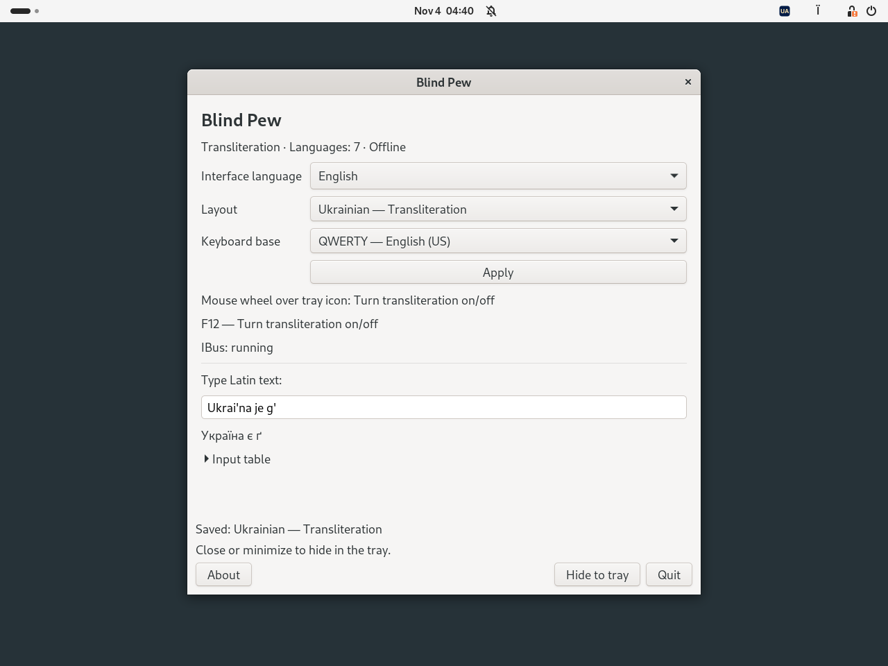
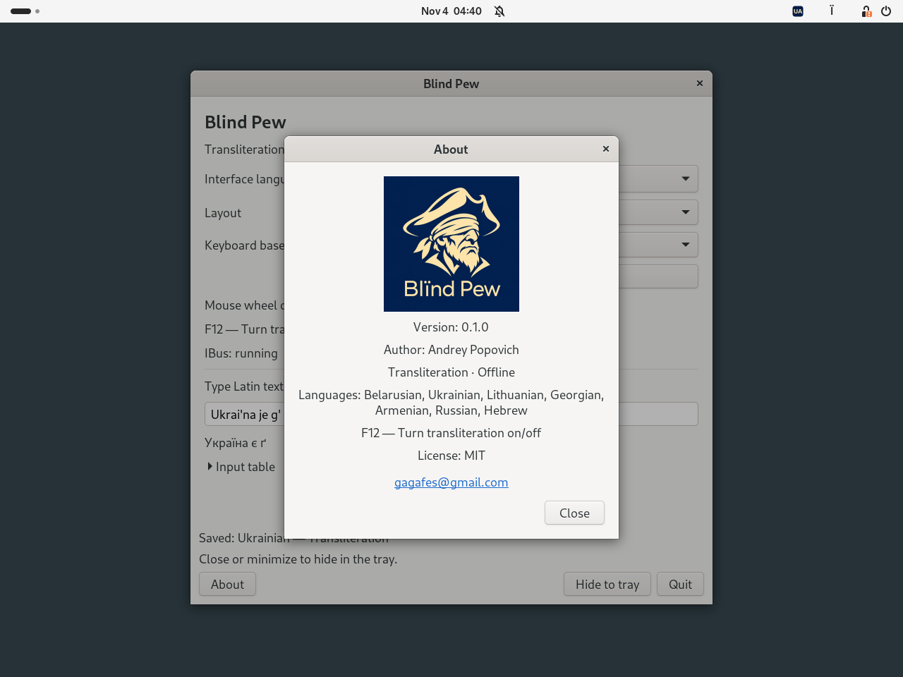

# Blind Pew

[Беларуская](README.be.md) · [Українська](README.uk.md) · [Deutsch](README.de.md) · [Русский](README.ru.md) · [English](README.md)

  

**0.1.0 · Debian 13 · Ubuntu 24.04 · XFCE / GNOME · MIT**

**[Спампаваць DEB 0.1.0-1 для Debian / Ubuntu](downloads/blind-pew_0.1.0-1_all.deb?raw=true)**
[Кантрольная сума SHA-256](downloads/SHA256SUMS)

Невялікі аўтаномны пераключальнік транслітарацыі. Выберыце мову і ўключайце
ці выключайце транслітарацыю клавішай **F12** або **колцам мышы над значком у трэі**.
Пераключэнне дзейнічае глабальна для праграм, падлучаных да IBus.

## Здымкі экрана

GNOME 46 / Wayland у Ubuntu 24.04; інтэрфейс праграмы — па-англійску.

**Налады і прыклад транслітарацыі**

**Пра Blind Pew**

## Мовы

| Мова | Прыклады |
|---|---|
| Беларуская | `w → ў`, `i → і`, `jo → ё` |
| Украінская | `i' → ї`, `je → є`, `g' → ґ` |
| Літоўская | `aa → ą`, `cx → č`, `ex → ė` |
| Грузінская | `sh → შ`, `gh → ღ`, `k' → კ` |
| Армянская | `sh → շ`, `u → ու`, `& → և` |
| Руская | `sh → ш`, `zh → ж`, `shh → щ` |
| Руская, правілы DE | `w → в`, `v → ф`, `tsch → ч` |
| Іўрыт | `sh → ש`, `ms → ם`, `ks → ך` |

Усе восем профіляў падтрымліваюць **QWERTY** і **QWERTZ**.
Адпаведнасці сімвалаў заснаваныя на функцыянальных табліцах
[Translit.ru](https://translit.ru/). Blind Pew — незалежны праект;
[звесткі пра крыніцы](docs/REFERENCE.md).

## Усталяванне і выкарыстанне

Спампуйце DEB, адкрыйце тэрмінал у каталогу з пакетам і выканайце:

~~~sh
sudo apt install ./blind-pew_0.1.0-1_all.deb
~~~

Выйдзіце з графічнага сеанса і ўвайдзіце зноў. Адкрыйце **Blind Pew** праз
меню праграм або камандай `blind-pew`. Пры патрэбе IBus запускаецца аўтаматычна;
ужо запушчаны працэс не перазапускаецца.

1. Выберыце профіль транслітарацыі і QWERTY або QWERTZ.
2. Націсніце **«Ужыць»**, каб уключыць выбраны профіль.
3. Націсніце **F12**, каб вярнуцца да папярэдняй звычайнай крыніцы ўводу.
   Наступнае націсканне зноў уключыць транслітарацыю.

Пракрутка ўверх ці ўніз над значком трэя выконвае тое ж пераключэнне.
Гарызантальная пракрутка ігнаруецца. Закрыццё або згортванне акна хавае
яго ў трэі; калі трэй недаступны, акно застаецца даступным.
SVG-значкі паказваюць код краіны: BY, UA, LT, GE, AM, RU або IL.
F12 дзейнічае, пакуль працуе Blind Pew. Пры выхадзе захаваныя спалучэнні клавіш
і налады ўводу аднаўляюцца, калі вы не змянілі іх асобна.

Знак `+` раздзяляе паслядоўнасці: `s+h → сх` у рускай, `a+a → aa` у літоўскай.
Канчатковыя формы іўрыту ўводзяцца яўна: `fs → ף`, `cs → ץ`, `ms → ם`,
`ns → ן`, `ks → ך`; `shloms → שלום`. Кірунак абзаца задаецца ў рэдактары.

## Працоўнае асяроддзе

У XFCE патрэбны **Status Tray Plugin** або вобласць апавяшчэнняў на панэлі.
Для трэя ў GNOME патрэбна **AppIndicator and KStatusNotifierItem Support**
або **Ubuntu AppIndicators**. Пры патрэбе:

~~~sh
sudo apt install gnome-shell-extension-appindicator
~~~

Пакет змяшчае **Blind Pew Integration** для GNOME Shell 46–48.
Праграма спрабуе ўключыць пашырэнне пры запуску. Калі з'явіцца падказка,
уключыце яго пасля ўваходу праз праграму пашырэнняў або камандай:

~~~sh
gnome-extensions enable blind-pew@local
~~~

Увод выкарыстоўвае IBus, у тым ліку `ibus-gtk4` для праграм GTK4.
Акно налад выкарыстоўвае GTK3. Кансолі TTY і экран уваходу не падтрымліваюцца.
Інтэрфейс і акно звестак пра праграму выкарыстоўваюць сістэмную мову;
рэзервовая мова — англійская. Даступныя 49 моў і варыянтаў пісьма.
Змена мовы прымяняецца адразу. Шрыфты ў наладах і звестках пра праграму
на 20% большыя за сістэмны памер. Акно звестак змяшчае лагатып і кантакты аўтара.

## Залежнасці

`python3 (>= 3.10)`, `python3-gi`, `gir1.2-ibus-1.0`, `gir1.2-gtk-3.0`,
`ibus (>= 1.5.29)`, `ibus-gtk3`, `ibus-gtk4`, `im-config`, `xfconf`,
`gir1.2-ayatanaappindicator3-0.1`.

APT усталюе патрэбныя сістэмныя пакеты; яны не ўключаныя ў DEB.
Дадатковы пакет для трэя GNOME — `gnome-shell-extension-appindicator`.
Бібліятэкі з pip не патрэбныя. Праграма працуе без інтэрнэту, не запісвае
ўведзены тэкст і не чытае буфер абмену. Транслітарацыя абмінае палі,
якія праграма пазначыла як Password, PIN або Private.

## Каманды і выдаленне

~~~sh
blind-pew doctor
blind-pew list
printf '%s\n' "Ukrai'na je g'" | blind-pew convert --profile ua
~~~

Профілі канвертара: `be`, `ua`, `li`, `ge`, `am`, `ru`, `rude`, `il`.
Параметр `--reverse` уключае пераўтварэнне ў лацінку.
Налады: `~/.config/blind-pew/settings.json` або каталог у `XDG_CONFIG_HOME`.

Перад выдаленнем выберыце звычайную крыніцу ўводу і завяршыце Blind Pew:

~~~sh
blind-pew disconnect
sudo apt remove blind-pew
~~~

## Зборка і праверка

Праграма напісаная на **Python 3** з PyGObject/IBus; пашырэнне GNOME — на
JavaScript/GJS. Для зборкі патрэбныя Python 3 і `dpkg-deb` з пакета `dpkg`.
Зборка нічога не спампоўвае.

~~~sh
python3 -m unittest discover -s tests -v
python3 tools/build.py
~~~

Пакет ствараецца ў `dist/`. Workflow GitHub Actions прызначаны для тэстаў
на Ubuntu 24.04 і захавання DEB як артэфакта зборкі.
[Інструкцыі і межы праверкі](docs/TESTING.md).

Аўтар пацвердзіў працу на **Debian 13 з XFCE 4.20**. Поўны сеанс GNOME/Wayland
і ўвод у GTK4, Qt, Electron і ізаляваных праграмах яшчэ патрабуюць праверкі
на камп'ютары. Каталогі перакладаў маюць аўтаматычныя праверкі;
усе 49 моў не праходзілі вычытку носьбітамі.

## Аўтар і ліцэнзія

**Andrey Popovich** · [gagafes@gmail.com](mailto:gagafes@gmail.com)

[Ліцэнзія MIT](LICENSE). Сістэмныя залежнасці захоўваюць уласныя ліцэнзіі.

## Удзел ШІ ў распрацоўцы

Распрацавана пры дапамозе **OpenAI Codex**. Канцэпцыя праекта, патрабаванні
і кіраўніцтва: **Andrey Popovich**.
