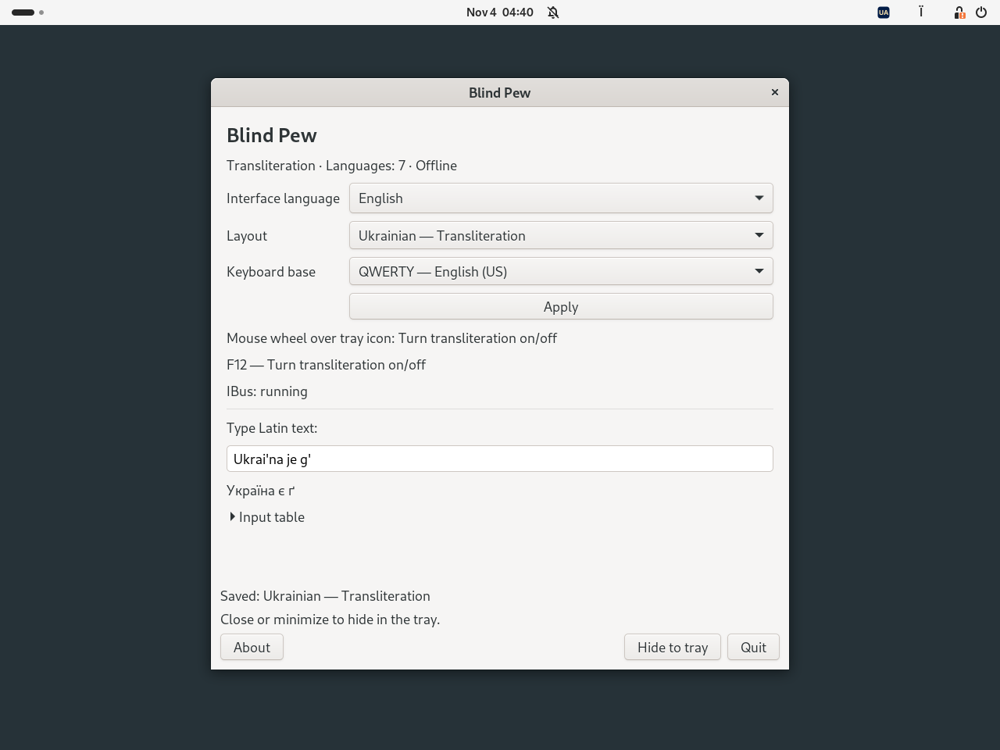
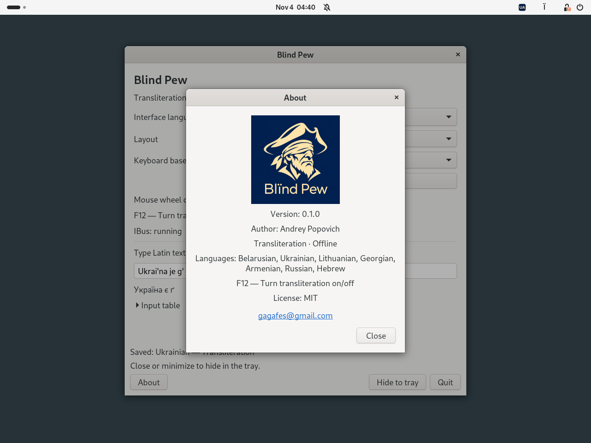

# Blind Pew

[Беларуская](README.be.md) · [Українська](README.uk.md) · [Deutsch](README.de.md) · [Русский](README.ru.md) · [English](README.md)

  

**0.1.0 · Debian 13 · Ubuntu 24.04 · XFCE / GNOME · MIT**

**[DEB 0.1.0-1 für Debian / Ubuntu herunterladen](downloads/blind-pew_0.1.0-1_all.deb?raw=true)**  
[SHA-256-Prüfsumme](downloads/SHA256SUMS)

Ein kleines Programm zur Offline-Transliteration. Sprache auswählen und
die Transliteration mit **F12** oder dem **Mausrad über dem Symbol im
Benachrichtigungsbereich** ein- und ausschalten. Die aktive Eingabequelle
gilt global für Anwendungen, die IBus verwenden.

## Bildschirmfotos

GNOME 46 / Wayland unter Ubuntu 24.04 mit englischer Programmoberfläche.

**Einstellungen und Transliterationsvorschau**

**Über Blind Pew**

## Sprachen

| Sprache | Beispiele |
|---|---|
| Belarussisch | `w → ў`, `i → і`, `jo → ё` |
| Ukrainisch | `i' → ї`, `je → є`, `g' → ґ` |
| Litauisch | `aa → ą`, `cx → č`, `ex → ė` |
| Georgisch | `sh → შ`, `gh → ღ`, `k' → კ` |
| Armenisch | `sh → շ`, `u → ու`, `& → և` |
| Russisch | `sh → ш`, `zh → ж`, `shh → щ` |
| Russisch, DE-Regeln | `w → в`, `v → ф`, `tsch → ч` |
| Hebräisch | `sh → ש`, `ms → ם`, `ks → ך` |

Alle acht Profile unterstützen **QWERTY** und **QWERTZ**.
Die Zeichenzuordnungen entsprechen den funktionalen Eingabetabellen von
[Translit.ru](https://translit.ru/). Blind Pew ist ein unabhängiges Projekt;
siehe [Angaben zu den Referenzen](docs/REFERENCE.md).

## Installation und Verwendung

DEB herunterladen, ein Terminal im Downloadordner öffnen und ausführen:

~~~sh
sudo apt install ./blind-pew_0.1.0-1_all.deb
~~~

Von der grafischen Sitzung abmelden und erneut anmelden. **Blind Pew**
über das Anwendungsmenü oder mit `blind-pew` öffnen. IBus startet bei Bedarf
automatisch; eine laufende Instanz wird nicht neu gestartet.

1. Transliterationsprofil und Tastaturbasis QWERTY oder QWERTZ auswählen.
2. **Anwenden** wählen. Die ausgewählte Transliteration wird aktiviert.
3. **F12** drücken, um zur zuvor verwendeten normalen Eingabequelle
   zurückzukehren. Erneutes Drücken aktiviert wieder die gewählte Transliteration.

Das Scrollen **nach oben oder unten über dem Symbol** schaltet genauso um.
Horizontales Scrollen wird ignoriert. Eine andere Sprache lässt sich in den
Einstellungen mit „Anwenden“ aktivieren. Schließen und Minimieren verbergen
das Fenster im Benachrichtigungsbereich. Ist dieser nicht verfügbar, bleibt
das Fenster zugänglich.

SVG-Symbole zeigen den aktuellen Ländercode: BY, UA, LT, GE, AM, RU oder IL.
F12 funktioniert, solange Blind Pew läuft. Beim Beenden werden die
gespeicherten Tastenkürzel und Eingabeeinstellungen wiederhergestellt,
sofern sie nicht unabhängig davon geändert wurden.

Mit `+` lassen sich Folgen trennen: `s+h → сх` auf Russisch,
`a+a → aa` auf Litauisch. Hebräische Schlussformen werden ausdrücklich
eingegeben: `fs → ף`, `cs → ץ`, `ms → ם`, `ns → ן`, `ks → ך`;
`shloms → שלום`. Die Absatzrichtung wird im Editor festgelegt.

## Desktop-Integration

XFCE benötigt das Panel-Element **Status Tray Plugin** oder **Benachrichtigungsfläche**.
GNOME benötigt **AppIndicator and KStatusNotifierItem Support** oder
**Ubuntu AppIndicators**. Bei Bedarf installieren:

~~~sh
sudo apt install gnome-shell-extension-appindicator
~~~

Das DEB enthält **Blind Pew Integration** für GNOME Shell 46–48.
Die Anwendung versucht, die Erweiterung beim Start zu aktivieren. Falls
ein Hinweis erscheint, nach der Anmeldung über „Erweiterungen“ oder
mit folgendem Befehl aktivieren:

~~~sh
gnome-extensions enable blind-pew@local
~~~

Die Eingabe erfolgt über IBus, einschließlich des Moduls `ibus-gtk4` für
GTK4-Anwendungen. Das Einstellungsfenster verwendet GTK3. TTY-Konsolen
und der Anmeldebildschirm werden nicht bedient.

Oberfläche und Infofenster verwenden standardmäßig die Systemsprache,
mit Englisch als Ersatz. Zur Auswahl stehen 49 Sprachen und Schriftvarianten;
Änderungen werden sofort wirksam. Die Schrift in den Einstellungen und im
Infofenster ist 20 % größer als die Systemschrift. Das Infofenster zeigt
das Blind-Pew-Logo und die Kontaktdaten des Autors.

## Abhängigkeiten

`python3 (>= 3.10)`, `python3-gi`, `gir1.2-ibus-1.0`, `gir1.2-gtk-3.0`,
`ibus (>= 1.5.29)`, `ibus-gtk3`, `ibus-gtk4`, `im-config`, `xfconf`,
`gir1.2-ayatanaappindicator3-0.1`.

APT installiert die benötigten Systempakete; sie sind nicht im DEB enthalten.
Die optionale Abhängigkeit für den GNOME-Benachrichtigungsbereich ist
`gnome-shell-extension-appindicator`. Python-Pakete aus pip sind nicht nötig.
Das Programm arbeitet offline, protokolliert keinen eingegebenen Text und
liest die Zwischenablage nicht aus. In Feldern, die eine Anwendung als
Password, PIN oder Private kennzeichnet, bleibt die Transliteration aus.

## Befehle und Deinstallation

~~~sh
blind-pew doctor
blind-pew list
printf '%s\n' "Ukrai'na je g'" | blind-pew convert --profile ua
~~~

Konverterprofile: `be`, `ua`, `li`, `ge`, `am`, `ru`, `rude`, `il`.
Mit `--reverse` wird in lateinische Zeichen umgewandelt.
Die Einstellungen liegen in `~/.config/blind-pew/settings.json`
bzw. unter `XDG_CONFIG_HOME`.

Vor der Deinstallation eine normale Eingabequelle auswählen und Blind Pew beenden:

~~~sh
blind-pew disconnect
sudo apt remove blind-pew
~~~

## Bauen und testen

Die Anwendung ist in **Python 3** mit PyGObject/IBus geschrieben,
die GNOME-Integration in JavaScript/GJS.
Zum Bauen werden Python 3 und `dpkg-deb` aus dem Paket `dpkg` benötigt;
der Build lädt nichts herunter.

~~~sh
python3 -m unittest discover -s tests -v
python3 tools/build.py
~~~

Das Paket wird in `dist/` erzeugt. GitHub Actions führt die Tests unter
Ubuntu 24.04 aus und stellt das DEB als Build-Artefakt bereit.
[Testanleitung und Prüfumfang auf Englisch](docs/TESTING.md).

Der Autor hat den Betrieb auf **Debian 13 mit XFCE 4.20** bestätigt.
Vollständige GNOME-/Wayland-Sitzungen sowie die durchgängige Texteingabe in
GTK4-, Qt-, Electron- und isolierten Anwendungen müssen noch am Desktop
geprüft werden. Die Übersetzungskataloge werden automatisch geprüft;
eine muttersprachliche Prüfung aller 49 Sprachen steht aus.

## Autor und Lizenz

**Andrey Popovich** · [gagafes@gmail.com](mailto:gagafes@gmail.com)

[MIT-Lizenz](LICENSE). Systemabhängigkeiten behalten ihre eigenen Lizenzen.

## Mitwirkung bei der Entwicklung

Entwickelt mit Unterstützung von **OpenAI Codex**. Projektidee, Anforderungen und Leitung: **Andrey Popovich**.
