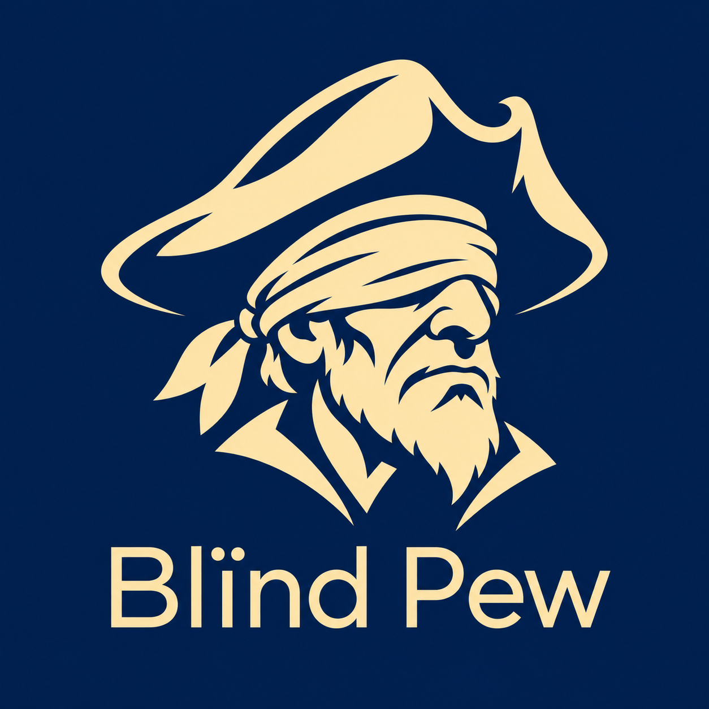
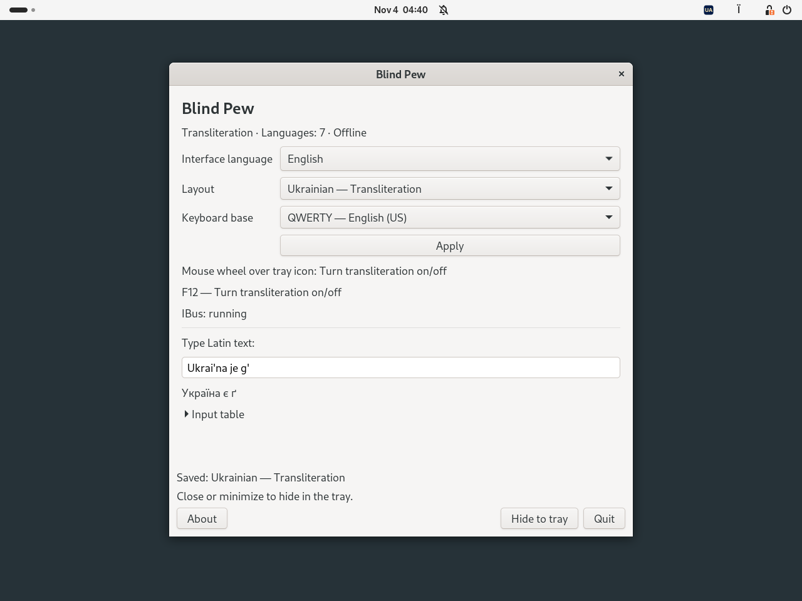
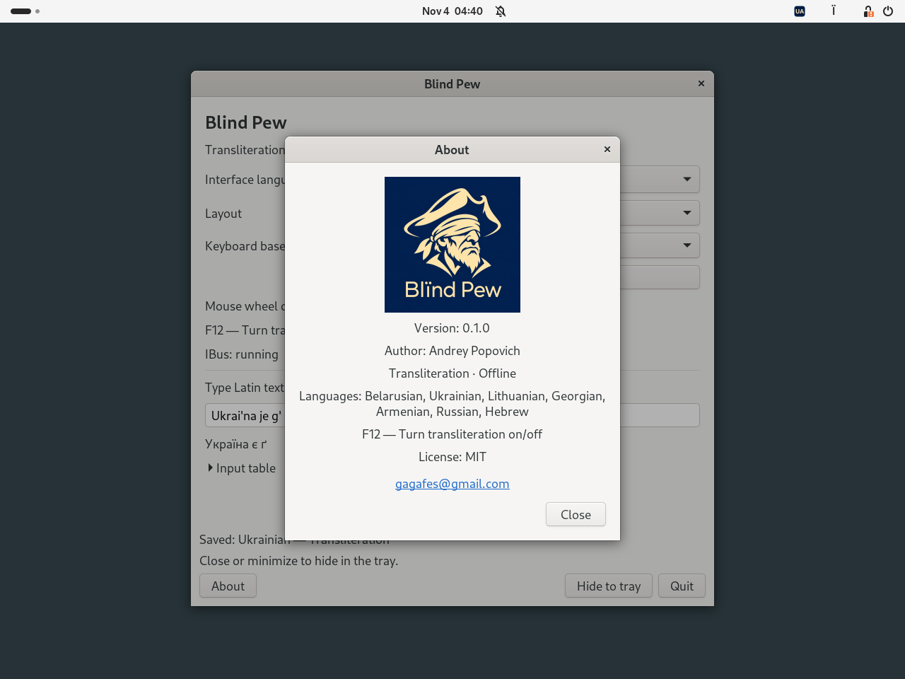

# Blind Pew

**Offline transliteration for Linux. Toggle with F12.**

[Беларуская](README.be.md) · [Українська](README.uk.md) · [Deutsch](README.de.md) · [Русский](README.ru.md) · [English](README.md)

  

**0.1.0 · Debian 13 · Ubuntu 24.04 · XFCE / GNOME · MIT**

**[Download DEB 0.1.0-2 for Debian / Ubuntu](https://github.com/gagafes/blind-pew/releases/download/v0.1.0-2/blind-pew_0.1.0-2_all.deb)**
[SHA-256 checksum](https://github.com/gagafes/blind-pew/releases/download/v0.1.0-2/SHA256SUMS)

A small offline transliteration switcher. Choose a language and use **F12**
or the **mouse wheel over the tray icon** to turn transliteration on or off.
The active source applies globally to applications connected to IBus.

Seven languages · eight profiles · QWERTY / QWERTZ · works offline.

[Latest release](https://github.com/gagafes/blind-pew/releases/latest) · [Install](#install-and-use) · [Report a bug](https://github.com/gagafes/blind-pew/issues)

## Screenshots

GNOME 46 / Wayland on Ubuntu 24.04, with the interface set to English.

**Settings and transliteration preview**

**About Blind Pew**

## Languages

| Language | Examples |
|---|---|
| Belarusian | `w → ў`, `i → і`, `jo → ё` |
| Ukrainian | `i' → ї`, `je → є`, `g' → ґ` |
| Lithuanian | `aa → ą`, `cx → č`, `ex → ė` |
| Georgian | `sh → შ`, `gh → ღ`, `k' → კ` |
| Armenian | `sh → շ`, `u → ու`, `& → և` |
| Russian | `sh → ш`, `zh → ж`, `shh → щ` |
| Russian, DE rules | `w → в`, `v → ф`, `tsch → ч` |
| Hebrew | `sh → ש`, `ms → ם`, `ks → ך` |

All eight profiles support **QWERTY** and **QWERTZ**. The character mappings follow
the functional input tables of [Translit.ru](https://translit.ru/).
Blind Pew is an independent project; see [reference information](docs/REFERENCE.md).

## Install and use

Download the DEB, open a terminal in its folder and run:

~~~sh
sudo apt install ./blind-pew_0.1.0-2_all.deb
~~~

Log out and back into your desktop session, then open **Blind Pew**
from the application menu or run `blind-pew`. IBus starts automatically
when needed; an already running instance is left running.

1. Choose a transliteration profile and QWERTY or QWERTZ.
2. Select **Apply**. The chosen transliteration becomes active.
3. Press **F12** to return to the ordinary source used before transliteration.
   Press F12 again to enable the selected transliteration.

Scrolling **up or down over the tray icon** performs the same toggle.
Horizontal scrolling is ignored. Choose another language in Settings and
select Apply. Closing or minimizing the window hides it in the tray.
If no tray is available, the window stays accessible.

The tray uses SVG icons and shows the active country code:
BY, UA, LT, GE, AM, RU or IL. F12 works while Blind Pew is running.
Quitting restores the saved shortcut and input settings, unless you have
changed them independently.

Use `+` to separate sequences: `s+h → сх` in Russian,
`a+a → aa` in Lithuanian. Hebrew final forms are entered explicitly:
`fs → ף`, `cs → ץ`, `ms → ם`, `ns → ן`, `ks → ך`;
`shloms → שלום`. Paragraph direction is controlled by the editor.

## Desktop integration

XFCE needs a **Status Tray Plugin** or **Notification Area** panel item.
GNOME needs **AppIndicator and KStatusNotifierItem Support** or
**Ubuntu AppIndicators**. Install it if needed:

~~~sh
sudo apt install gnome-shell-extension-appindicator
~~~

The DEB includes **Blind Pew Integration** for GNOME Shell 46–48.
The application attempts to enable it at startup. If prompted, enable it
after logging in through Extensions or run:

~~~sh
gnome-extensions enable blind-pew@local
~~~

Input works through IBus, including the `ibus-gtk4` module for GTK4
applications. The settings window uses GTK3. TTY consoles and the login
screen are outside the application's scope.

The interface and About dialog use the system language by default, with
English as the fallback. You can choose from 49 interface languages and
writing variants; changes take effect immediately. Settings and About use
fonts 20% larger than the system size. The About dialog includes the
Blind Pew logo and author contact.

## Dependencies

`python3 (>= 3.10)`, `python3-gi`, `gir1.2-ibus-1.0`, `gir1.2-gtk-3.0`,
`ibus (>= 1.5.29)`, `ibus-gtk3`, `ibus-gtk4`, `im-config`, `xfconf`, `libxfconf-0-3`,
`gir1.2-ayatanaappindicator3-0.1`.

APT installs these system packages as needed; they are not bundled into the
DEB. The optional GNOME tray dependency is
`gnome-shell-extension-appindicator`. No Python packages from pip are needed.
The program works offline, does not log typed text or read the clipboard,
and bypasses transliteration in fields marked Password, PIN or Private by
the application.

## Commands and removal

~~~sh
blind-pew doctor
blind-pew list
printf '%s\n' "Ukrai'na je g'" | blind-pew convert --profile ua
~~~

Converter profiles: `be`, `ua`, `li`, `ge`, `am`, `ru`, `rude`, `il`.
Use `--reverse` for conversion to Latin characters.
Preferences are stored in `~/.config/blind-pew/settings.json`
(or under `XDG_CONFIG_HOME`).

Before uninstalling, switch to an ordinary input source and quit Blind Pew:

~~~sh
blind-pew disconnect
sudo apt remove blind-pew
~~~

## Build and test

The application is written in **Python 3** with PyGObject/IBus.
The GNOME integration uses JavaScript/GJS.
Building requires Python 3 and `dpkg-deb` from `dpkg`; it downloads nothing.

~~~sh
python3 -m unittest discover -s tests -v
python3 tools/build.py
~~~

The package is created in `dist/`. GitHub Actions tests Ubuntu 24.04 and
Debian 13, including installed packages, Xfce, GTK3/GTK4 input and a headless
GNOME/Wayland session. It stores DEBs and test logs as build artifacts.
[Test instructions, CI scope and remaining manual checks](docs/TESTING.md).

The author has confirmed operation on **Debian 13 with XFCE 4.20**.
Qt, Electron, sandboxed applications and physical keyboard/mouse behavior
need further desktop testing. Translation catalogs have automated checks;
all 49 languages have not been reviewed by native speakers.

## Author and license

**Andrey Popovich** · [gagafes@gmail.com](mailto:gagafes@gmail.com)

[MIT License](LICENSE). System dependencies retain their own licenses.

[Licensing and provenance](THIRD_PARTY_NOTICES.md) · [Comparison with similar projects (Russian)](docs/COMPARISON.md)

## Development attribution

Developed with assistance from **OpenAI Codex**. Project concept, requirements, and direction: **Andrey Popovich**.

