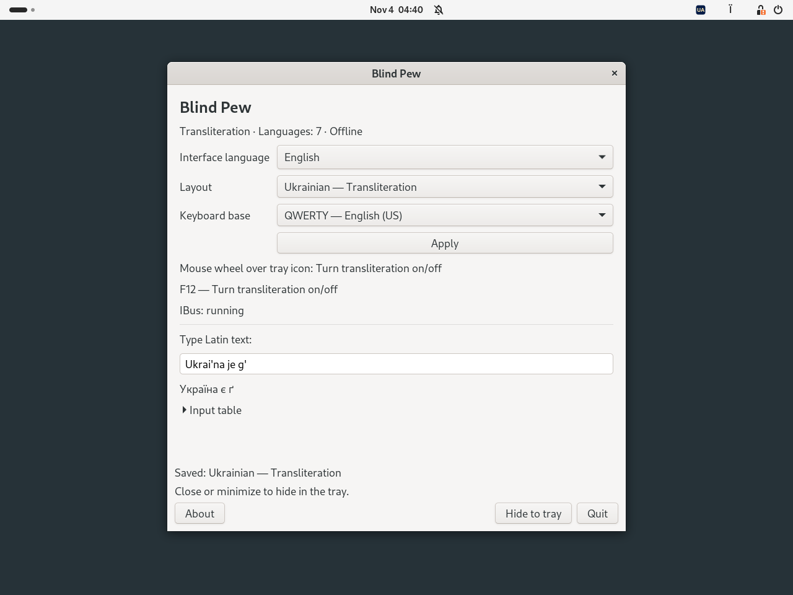
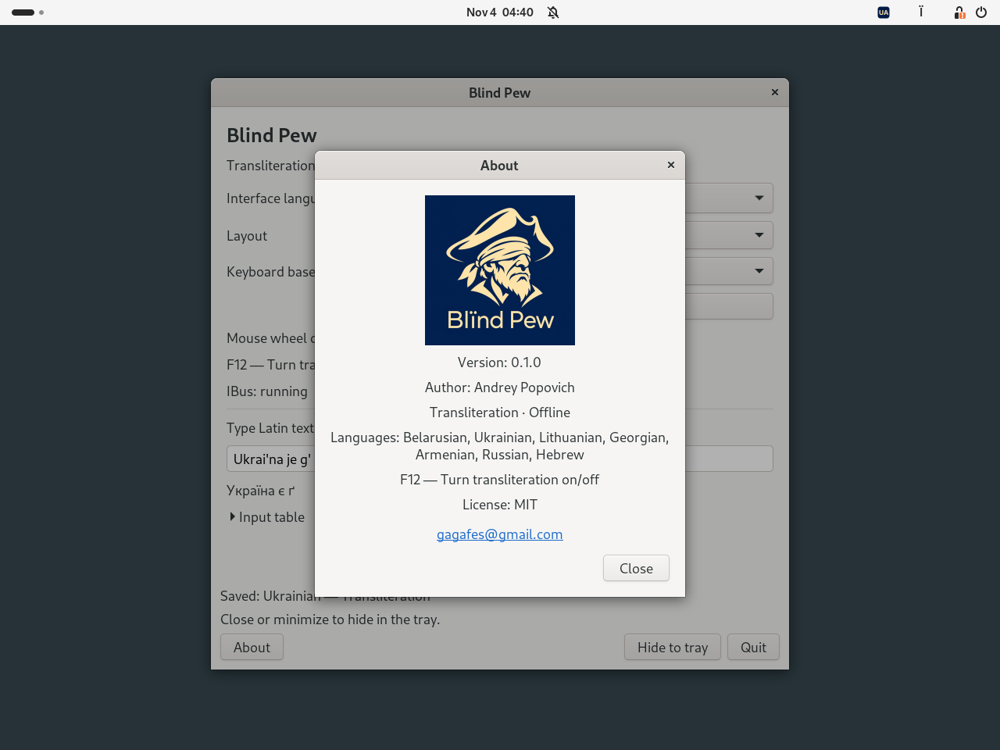

# Blind Pew

[Беларуская](README.be.md) · [Українська](README.uk.md) · [Deutsch](README.de.md) · [Русский](README.ru.md) · [English](README.md)

  

**0.1.0 · Debian 13 · Ubuntu 24.04 · XFCE / GNOME · MIT**

**[Скачать DEB 0.1.0-1 для Debian / Ubuntu](downloads/blind-pew_0.1.0-1_all.deb?raw=true)**  
[Контрольная сумма SHA-256](downloads/SHA256SUMS)

Небольшой офлайн-переключатель транслита. Выберите язык и включайте или
выключайте транслит клавишей **F12** или **колёсиком мыши над значком трея**.
Переключение глобальное для приложений, подключённых к IBus.

## Скриншоты

GNOME 46 / Wayland в Ubuntu 24.04; интерфейс программы — английский.

**Настройки и пример транслитерации**

**О программе Blind Pew**

## Языки

| Язык | Примеры |
|---|---|
| Белорусский | `w → ў`, `i → і`, `jo → ё` |
| Украинский | `i' → ї`, `je → є`, `g' → ґ` |
| Литовский | `aa → ą`, `cx → č`, `ex → ė` |
| Грузинский | `sh → შ`, `gh → ღ`, `k' → კ` |
| Армянский | `sh → շ`, `u → ու`, `& → և` |
| Русский | `sh → ш`, `zh → ж`, `shh → щ` |
| Русский, правила DE | `w → в`, `v → ф`, `tsch → ч` |
| Иврит | `sh → ש`, `ms → ם`, `ks → ך` |

Все восемь профилей поддерживают **QWERTY** и **QWERTZ**.
Соответствия символов следуют функциональным таблицам
[Translit.ru](https://translit.ru/). Blind Pew — независимый проект;
[сведения об источниках](docs/REFERENCE.md).

## Установка и использование

Скачайте DEB, откройте терминал в папке с пакетом и выполните:

~~~sh
sudo apt install ./blind-pew_0.1.0-1_all.deb
~~~

Выйдите и снова войдите в графический сеанс. Откройте **Blind Pew** через
меню приложений или командой `blind-pew`. При необходимости IBus запустится
автоматически; уже работающий экземпляр не перезапускается.

1. Выберите профиль транслита и основу QWERTY или QWERTZ.
2. Нажмите **«Применить»** — выбранный транслит включится.
3. Нажмите **F12**, чтобы вернуться к обычному источнику ввода,
   использованному до транслита. Следующее нажатие снова включит транслит.

Прокрутка **вверх или вниз над значком трея** выполняет то же переключение.
Горизонтальная прокрутка игнорируется. Для смены языка выберите его в
настройках и нажмите «Применить». Закрытие и сворачивание окна скрывают
его в трее. Если трей недоступен, окно остаётся доступным.

В трее используются SVG-значки с кодом страны: BY, UA, LT, GE, AM, RU или IL.
F12 работает, пока запущен Blind Pew. При выходе восстанавливаются сохранённые
назначения клавиш и настройки ввода, если вы не изменили их отдельно.

Разделяйте сочетания знаком `+`: `s+h → сх` в русском,
`a+a → aa` в литовском. Конечные формы иврита вводятся явно:
`fs → ף`, `cs → ץ`, `ms → ם`, `ns → ן`, `ks → ך`;
`shloms → שלום`. Направление абзаца задаёт редактор.

## Рабочее окружение

В XFCE нужен элемент панели **Status Tray Plugin** или **«Область уведомлений»**.
В GNOME — расширение **AppIndicator and KStatusNotifierItem Support**
или **Ubuntu AppIndicators**. При необходимости установите его:

~~~sh
sudo apt install gnome-shell-extension-appindicator
~~~

В DEB входит расширение **Blind Pew Integration** для GNOME Shell 46–48.
Программа пытается включить его при запуске. Если появится подсказка,
включите его после входа в сеанс через приложение «Расширения» или командой:

~~~sh
gnome-extensions enable blind-pew@local
~~~

Ввод работает через IBus, включая модуль `ibus-gtk4` для приложений GTK4.
Окно настроек использует GTK3. Консоли TTY и экран входа не обслуживаются.

Интерфейс и окно «О программе» по умолчанию используют системный язык;
резервный язык — английский. Доступны 49 языков и вариантов письма,
смена языка применяется сразу. Шрифты в настройках и окне «О программе»
на 20% крупнее системного размера. В окне «О программе» показаны логотип
со слепым Пью и контакты автора.

## Зависимости

`python3 (>= 3.10)`, `python3-gi`, `gir1.2-ibus-1.0`, `gir1.2-gtk-3.0`,
`ibus (>= 1.5.29)`, `ibus-gtk3`, `ibus-gtk4`, `im-config`, `xfconf`,
`gir1.2-ayatanaappindicator3-0.1`.

APT установит необходимые системные пакеты; в DEB они не включены.
Дополнительная зависимость для трея GNOME —
`gnome-shell-extension-appindicator`. Установка библиотек через pip не нужна.
Программа работает офлайн, не записывает вводимый текст и не читает буфер
обмена. В полях, которые приложение обозначило как Password, PIN или Private,
преобразование отключается.

## Команды и удаление

~~~sh
blind-pew doctor
blind-pew list
printf '%s\n' "Ukrai'na je g'" | blind-pew convert --profile ua
~~~

Профили конвертера: `be`, `ua`, `li`, `ge`, `am`, `ru`, `rude`, `il`.
Параметр `--reverse` включает преобразование в латиницу.
Настройки сохраняются в `~/.config/blind-pew/settings.json`
или в каталоге, заданном через `XDG_CONFIG_HOME`.

Перед удалением выберите обычный источник ввода и завершите Blind Pew:

~~~sh
blind-pew disconnect
sudo apt remove blind-pew
~~~

## Сборка и проверка

Программа написана на **Python 3** с PyGObject/IBus,
расширение GNOME — на JavaScript/GJS.
Для сборки нужны Python 3 и `dpkg-deb` из пакета `dpkg`; сеть не используется.

~~~sh
python3 -m unittest discover -s tests -v
python3 tools/build.py
~~~

Пакет появится в `dist/`. GitHub Actions запускает тесты на Ubuntu 24.04
и сохраняет DEB в артефактах сборки.
[Команды и границы проверки, на английском](docs/TESTING.md).

Автор подтвердил работу на **Debian 13 с XFCE 4.20**.
Полный сеанс GNOME/Wayland и сквозной ввод в GTK4, Qt, Electron
и изолированных приложениях ещё требуют проверки на компьютере.
Каталоги переводов проходят автоматические проверки; вычитка носителями
всех 49 языков не проводилась.

## Автор и лицензия

**Andrey Popovich** · [gagafes@gmail.com](mailto:gagafes@gmail.com)

[Лицензия MIT](LICENSE). Системные зависимости сохраняют собственные лицензии.

## Участие ИИ в разработке

Разработано при содействии **OpenAI Codex**. Концепция проекта, требования и руководство: **Andrey Popovich**.
