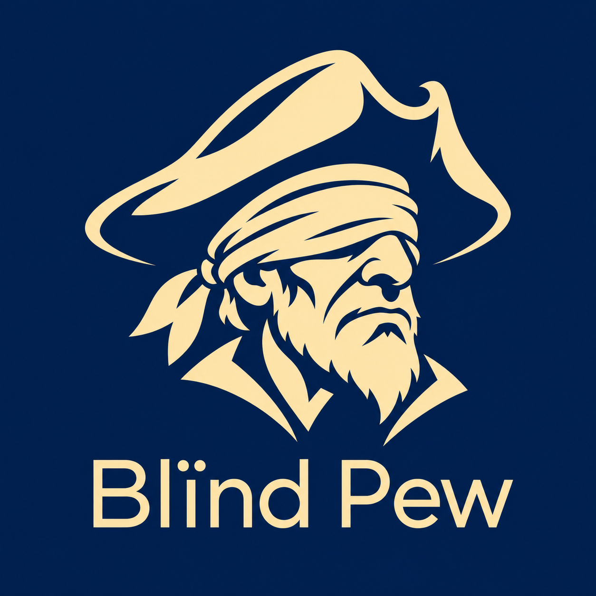
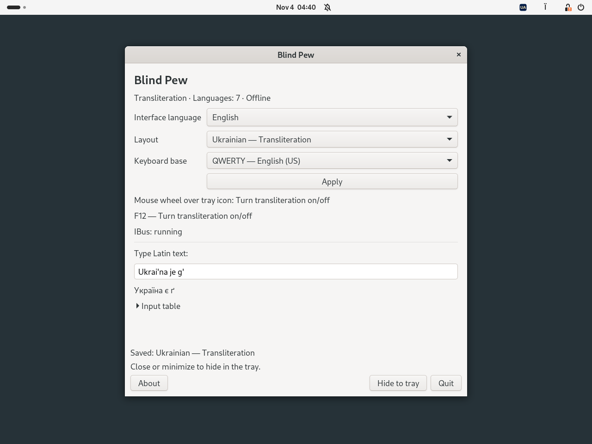
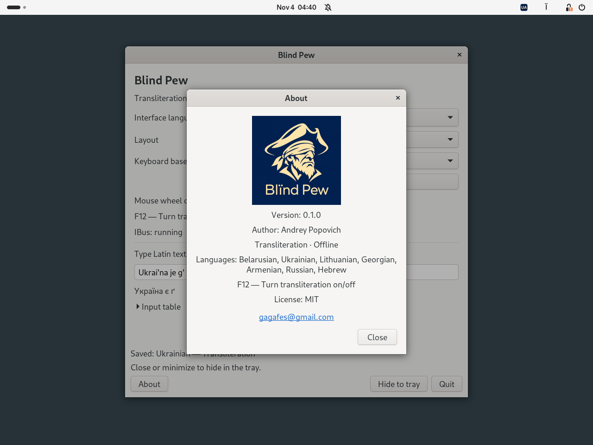

# Blind Pew

[Беларуская](README.be.md) · [Українська](README.uk.md) · [Deutsch](README.de.md) · [Русский](README.ru.md) · [English](README.md)

  

**0.1.0 · Debian 13 · Ubuntu 24.04 · XFCE / GNOME · MIT**

**[Завантажити DEB 0.1.0-2 для Debian / Ubuntu](https://github.com/gagafes/blind-pew/releases/download/v0.1.0-2/blind-pew_0.1.0-2_all.deb)**
[Контрольна сума SHA-256](https://github.com/gagafes/blind-pew/releases/download/v0.1.0-2/SHA256SUMS)

Невеликий офлайн-перемикач трансліту. Виберіть мову та вмикайте або
вимикайте трансліт клавішею **F12** чи **коліщатком миші над значком у треї**.
Перемикання глобальне для застосунків, підключених до IBus.

## Знімки екрана

GNOME 46 / Wayland в Ubuntu 24.04; мова інтерфейсу програми — англійська.

**Налаштування та приклад транслітерації**

**Про Blind Pew**

## Мови

| Мова | Приклади |
|---|---|
| Білоруська | `w → ў`, `i → і`, `jo → ё` |
| Українська | `i' → ї`, `je → є`, `g' → ґ` |
| Литовська | `aa → ą`, `cx → č`, `ex → ė` |
| Грузинська | `sh → შ`, `gh → ღ`, `k' → კ` |
| Вірменська | `sh → շ`, `u → ու`, `& → և` |
| Російська | `sh → ш`, `zh → ж`, `shh → щ` |
| Російська, правила DE | `w → в`, `v → ф`, `tsch → ч` |
| Іврит | `sh → ש`, `ms → ם`, `ks → ך` |

Усі вісім профілів підтримують **QWERTY** та **QWERTZ**.
Відповідності символів відтворюють функціональні таблиці
[Translit.ru](https://translit.ru/). Blind Pew — незалежний проєкт;
[відомості про джерела](docs/REFERENCE.md).

## Встановлення та використання

Завантажте DEB, відкрийте термінал у теці з пакунком і виконайте:

~~~sh
sudo apt install ./blind-pew_0.1.0-2_all.deb
~~~

Вийдіть із графічного сеансу та увійдіть знову. Відкрийте **Blind Pew**
через меню застосунків або командою `blind-pew`. За потреби IBus запуститься
автоматично; уже запущений екземпляр не перезапускається.

1. Виберіть профіль трансліту та основу QWERTY або QWERTZ.
2. Натисніть **«Застосувати»** — вибраний трансліт увімкнеться.
3. Натисніть **F12**, щоб повернутися до звичайного джерела введення,
   використаного перед транслітом. Наступне натискання знову ввімкне трансліт.

Прокручування **вгору або вниз над значком у треї** виконує те саме перемикання.
Горизонтальне прокручування ігнорується. Щоб змінити мову, виберіть її в
налаштуваннях і натисніть «Застосувати». Закриття та згортання вікна приховують
його в треї. Якщо трей недоступний, вікно залишається доступним.

У треї використовуються SVG-значки з кодом країни: BY, UA, LT, GE, AM, RU або IL.
F12 працює, поки запущено Blind Pew. Після виходу відновлюються збережені
призначення клавіш і налаштування введення, якщо ви не змінили їх окремо.

Розділяйте послідовності знаком `+`: `s+h → сх` у російській,
`a+a → aa` у литовській. Кінцеві форми івриту вводяться явно:
`fs → ף`, `cs → ץ`, `ms → ם`, `ns → ן`, `ks → ך`;
`shloms → שלום`. Напрямок абзацу задає редактор.

## Стільничне середовище

У XFCE потрібен елемент панелі **Status Tray Plugin** або **«Область сповіщень»**.
У GNOME — розширення **AppIndicator and KStatusNotifierItem Support**
або **Ubuntu AppIndicators**. За потреби встановіть його:

~~~sh
sudo apt install gnome-shell-extension-appindicator
~~~

DEB містить розширення **Blind Pew Integration** для GNOME Shell 46–48.
Програма намагається ввімкнути його під час запуску. Якщо з'явиться підказка,
увімкніть розширення після входу в сеанс через застосунок «Розширення» або командою:

~~~sh
gnome-extensions enable blind-pew@local
~~~

Введення працює через IBus, зокрема модуль `ibus-gtk4` для застосунків GTK4.
Вікно налаштувань використовує GTK3. Консолі TTY та екран входу не обслуговуються.

Інтерфейс і вікно «Про програму» за замовчуванням використовують системну
мову; резервна мова — англійська. Доступні 49 мов і варіантів письма,
зміна мови застосовується одразу. Шрифти в налаштуваннях і вікні «Про програму»
на 20% більші за системний розмір. У вікні «Про програму» показано логотип
зі сліпим П'ю та контакти автора.

## Залежності

`python3 (>= 3.10)`, `python3-gi`, `gir1.2-ibus-1.0`, `gir1.2-gtk-3.0`,
`ibus (>= 1.5.29)`, `ibus-gtk3`, `ibus-gtk4`, `im-config`, `xfconf`, `libxfconf-0-3`,
`gir1.2-ayatanaappindicator3-0.1`.

APT встановить потрібні системні пакунки; до DEB вони не включені.
Додаткова залежність для трея GNOME —
`gnome-shell-extension-appindicator`. Встановлення бібліотек через pip не потрібне.
Програма працює офлайн, не записує введений текст і не читає буфер обміну.
У полях, які застосунок позначив як Password, PIN або Private,
перетворення вимикається.

## Команди та видалення

~~~sh
blind-pew doctor
blind-pew list
printf '%s\n' "Ukrai'na je g'" | blind-pew convert --profile ua
~~~

Профілі конвертера: `be`, `ua`, `li`, `ge`, `am`, `ru`, `rude`, `il`.
Параметр `--reverse` вмикає перетворення на латиницю.
Налаштування зберігаються у `~/.config/blind-pew/settings.json`
або в каталозі, заданому через `XDG_CONFIG_HOME`.

Перед видаленням виберіть звичайне джерело введення та закрийте Blind Pew:

~~~sh
blind-pew disconnect
sudo apt remove blind-pew
~~~

## Збирання та перевірка

Програму написано на **Python 3** з PyGObject/IBus,
розширення GNOME — на JavaScript/GJS.
Для збирання потрібні Python 3 та `dpkg-deb` із пакунка `dpkg`; мережа не потрібна.

~~~sh
python3 -m unittest discover -s tests -v
python3 tools/build.py
~~~

Пакунок з'явиться в `dist/`. GitHub Actions перевіряє Ubuntu 24.04 і Debian 13:
встановлення пакунка, XFCE, введення через GTK3/GTK4 та GNOME/Wayland
із віртуальним екраном. DEB і журнали зберігаються в артефактах збирання.
[Команди, межі автоматичних і ручних перевірок](docs/TESTING.md).

Автор підтвердив роботу на **Debian 13 із XFCE 4.20**. Qt, Electron,
ізольовані застосунки, фізичні клавіатури й миші потребують подальшої
перевірки. Каталоги перекладів проходять автоматичні перевірки; вичитування
носіями всіх 49 мов не проводилося.

## Автор і ліцензія

**Andrey Popovich** · [gagafes@gmail.com](mailto:gagafes@gmail.com)

[Ліцензія MIT](LICENSE). Системні залежності зберігають власні ліцензії.

[Ліцензії та походження компонентів](THIRD_PARTY_NOTICES.md) · [Порівняння з аналогами](docs/COMPARISON.md)

## Участь ШІ в розробці

Розроблено за допомогою **OpenAI Codex**. Концепція проєкту, вимоги та керівництво: **Andrey Popovich**.
